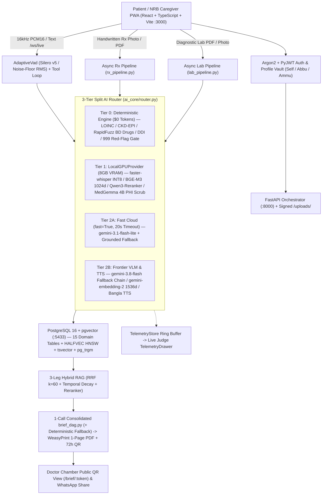

# MediTrackAI — Comprehensive Project Description & Technical Architecture Dossier

> **Bilingual, Neuro-Symbolic Longitudinal Clinical Memory Platform for Bangladesh & the Global Diaspora**  
> Speak in **Bangla or Banglish**. Verify against **DGDA Brands & LOINC Units Deterministically**. Deliver a **1-Page English Doctor Brief + 72-Hour QR Code** at every consultation—powered by a **3-Tier Split AI Architecture** engineered for Bangladesh's clinical realities and USD/FX economics.

---

## Executive Summary & Rubric Navigation Map

Healthcare in Bangladesh operates on disconnected paper folders. A chronic patient visits multiple specialist chambers, carries handwritten prescriptions containing Bangladeshi brand names and `1+0+1` dosing schedules, collects diagnostic printouts from separate labs mixing `mmol/L`, `mg/dL`, and `umol/L`, and gets less than three minutes of face time with a busy physician.

**MediTrackAI** solves this continuity gap without behaving like a hallucination-prone medical chatbot. It separates **language & vision perception** from **deterministic clinical logic**, runs an **ultra-cost-efficient 3-Tier Split AI Router** (`hybrid_gpu` or `cloud`), indexes longitudinal medical records inside **PostgreSQL 16 + `pgvector` Hybrid RAG**, enforces hard-coded safety gates, and translates months of family health history into a verifiable, **one-page English Doctor Brief** accessible via an expiring QR code.

### Judging Rubric Quick-Reference Map

| # | Marking Criterion | Weight | Score Target Band | Primary Proof Points in This Document |
| :---: | :--- | :---: | :---: | :--- |
| **—** | **Platform Differentiation** | *Core Thesis* | *Top Decile* | [Why MediTrackAI Is the Most Sophisticated Platform](#why-meditrackai-is-the-most-sophisticated-platform-for-this-job) (10-dimension architectural superiority matrix) |
| **1** | **Innovation** | **20%** | 16–20 | [Segment 1 — Innovation](#segment-1--innovation-020--20) (Neuro-symbolic core, 3-Tier Split AI, Banglish-to-LOINC Hybrid RAG, Bilingual Asymmetry, Cross-doctor polypharmacy reconciliation) |
| **2** | **Technical Execution** | **20%** | 16–20 | [Segment 2 — Technical Execution](#segment-2--technical-execution-020--20) (Dual-mode router, 15-table PostgreSQL/`pgvector` schema, `HALFVEC`+BM25+`pg_trgm` RRF, CKD-EPI 2021, Silero/Adaptive VAD, WeasyPrint PDF + QR, live `TelemetryDrawer`, 8/8 `pytest`) |
| **3** | **Business Model (+ Global Readiness)** | **20%** | 16–20 | [Segment 3 — Business Model + Global Readiness](#segment-3--business-model--global-readiness-020--20) (Split AI cost `\$0.26–\$0.43` vs `\$0.61–\$1.10`/MAU/mo, FX shield, B2C `BDT 299` bKash/Nagad, NRB `\$4.99` Stripe, B2B2C `BDT 10–15`/report QR moat, cross-border portability) |
| **4** | **Real-World Impact (+ Ethical AI)** | **20%** | 16–20 | [Segment 4 — Real-World Impact + Ethical AI Compliance](#segment-4--real-world-impact--ethical-ai-compliance-020--20) (NCD & Dengue impact, strict non-diagnostic CDS, `999` red-flag gate, `<0.85` HITL confirmation, Argon2/JWT + signed files + PDPA 2026 roadmap, dialect equity) |
| **5** | **Scalability (+ NRB Collaboration)** | **10%** | 8–10 | [Segment 5 — Scalability + NRB Collaboration](#segment-5--scalability--nrb-collaboration-010--10) (`hybrid_gpu` → `L4/A10G` vLLM + ColPali + Redis/ARQ + 20k DGDA, Opus 16–24 kbps, NRB caregiver loop + global/Mac builder onboarding) |
| **6** | **Presentation** | **10%** | 8–10 | [Segment 6 — Presentation, Storytelling & Live Demo Guide](#segment-6--presentation-storytelling--live-demo-guide-010--10) (`Abbu` cross-lab/cross-doctor narrative, 4-tab live walkthrough, Telemetry Drawer proof, Judge Q&A matrix) |

---

## Why MediTrackAI Is the Most Sophisticated Platform for This Job

Most digital health prototypes fall into one of three failure modes in Bangladesh:
1. **Generic LLM Wrappers** pass raw transcripts, lab images, and medication lists straight to expensive cloud models—burning USD API budget on routine math, hallucinating eGFR/glucose conversions, misreading local brands like *Seclo* or *Bizoran*, and leaking raw PII across borders.
2. **Western EHR / Health Apps** assume English-literate users, interoperable FHIR/HL7 hospital APIs, uniform lab units, and credit-card subscriptions—failing in a paper-first market dominated by Bangla speech, `mmol/L` vs. `mg/dL` lab printouts, and bKash/Nagad payments.
3. **Local Transactional Apps** (online pharmacies and single tele-consult apps) optimize for one-off medicine delivery or 5-minute video calls—discarding longitudinal context the moment the consultation ends.

**MediTrackAI is purpose-engineered from the database schema up to dominate all three gaps simultaneously.**

### 10-Dimension Head-to-Head Architectural Comparison

| Engineering & Product Dimension | Generic All-Cloud LLM Wrappers | Western EHR / Consumer Apps | Local e-Pharmacy / Telemed Apps | **MediTrackAI Platform** |
| :--- | :--- | :--- | :--- | :--- |
| **1. Cost-Efficient AI Routing** | Every call hits costly flagship cloud models (`\$0.61–\$1.10` / MAU / mo) | N/A or brittle rule forms | Minimal / manual call centers | **3-Tier Split AI Router:** Deterministic Tier 0 (`\$0`) + Local 8 GB GPU Tier 1 (`faster-whisper`, `BGE-M3`, `Qwen3-Reranker`, `MedGemma 4B`) + Precision Cloud Tier 2 (**`\$0.26–\$0.43` / MAU / mo**, cutting USD burn **60–75%**) |
| **2. Clinical Math & Triage Safety** | Prompted LLM arithmetic (hallucination risk on eGFR/units) | Manual doctor entry | Human doctor only | **Neuro-Symbolic Separation:** Pure Python/SQL handles `mmol/L`↔`mg/dL`, CKD-EPI 2021 eGFR, ADA thresholds, DDI rules, and Bangladesh `999` / Dengue platelet red-flag gating deterministically (**0% math hallucination**) |
| **3. Cross-Lingual Retrieval Depth** | Naive top-k cosine vector similarity in one language | Keyword filter / no RAG | Flat order history list | **3-Leg Hybrid Clinical RAG:** Banglish glossary query expansion + `pgvector` `HALFVEC` HNSW + `tsvector` BM25 + `pg_trgm` BD Drug Catalog expansion → RRF (`k=60`) → Exponential temporal decay → Cross-encoder rerank |
| **4. Bilingual Workflow Asymmetry** | Same language in/out; walls of chat text doctors cannot read | English-only UI | Bangla call / basic notes | **Bangla/Banglish Patient Input → 1-Page English Doctor Brief + QR:** Matches how patients actually speak and how Bangladeshi MBBS/FCPS doctors actually review charts |
| **5. Cross-Lab & Chamber Continuity** | Single-document chat without longitudinal tracking | Locked inside one hospital network | Locked inside one telemed app | **Longitudinal Cross-Facility Vault:** Reconciles Popular, Ibn Sina, Labaid, Square, and chamber pads onto unified LOINC timelines + `clinical_edges` causal graph |
| **6. BD Pharmacovigilance & HITL** | Frequently hallucinates `Seclo`/`Sergel` or invented dosages | US RxNorm/NDC only (unaware of BD brands) | Cart SKU search only | **BD Brand Verifier:** `pg_trgm` + RapidFuzz `WRatio` against curated DGDA formulary, `1+0+1` dosing parse, cross-Rx duplicate class alerts, and **confidence-gated Human-in-the-Loop** (`>=0.85`, `0.60–0.84`, `<0.60`) |
| **7. Sovereign Privacy & PDPA 2026** | Sends unredacted NIDs, phones, & clinical records to external APIs | HIPAA/GDPR without BD context | Basic phone login | **Sovereign-Ready Architecture:** Local `MedGemma 4B` + BD regex PHI redaction pre-cloud, Argon2+JWT, strict `patient_profile_id` isolation, HMAC-signed `/uploads/`, versioned `pdpa_consents`, Phase 2 KMS/RLS/Vertex ZDR |
| **8. Fail-Fast Resilience** | Multi-agent chains stall (`45s+`) or fail completely on transient `503`s | Static forms | Manual retry | **Production Resilience:** Single consolidated structured `brief_dag.py` call with deterministic fallback narrative, `20000ms` single-attempt HTTP timeouts, fast-path model routing (`gemini-3.1-flash-lite`), `22.0s` RAG citation fallback |
| **9. Radical AI Explainability** | Black-box chat bubble with no provenance | Static tables | None | **Live Telemetry Drawer:** Ring buffer exposing exact embedding backend, reranker backend, per-hit vector/BM25/trigram/RRF/decay/rerank scores, `[Rx #id]`/`[Lab #id]` citations, PII diffs, and voice tool calls |
| **10. Unit Economics & Scalability** | Margin collapses under BD USD FX card caps | Requires `$15–30/mo` pricing | High CAC paid ads | **Negative-CAC B2B2C + Split AI Margin:** Diagnostic center QR (`BDT 10–15/report`) feeds `BDT 299/mo` Family Care & `\$4.99/mo` NRB Diaspora tiers at ~80%+ projected software contribution margin |

### Why Only This Level of Engineering Works in Bangladesh
1. **Polypharmacy happens across chambers, not inside one EHR:** An elderly patient receives *Seclo* (Omeprazole) from a cardiologist at Square Hospital and *Sergel* (Esomeprazole) two weeks later from a gastroenterologist at Popular Medical College. Solving that requires cross-encounter medication episode persistence (`medication_episodes`), fuzzy brand-to-generic resolution (`bd_drug_catalog`), and deterministic class-overlap rules (`bd_ddi_rules`)—not a stateless PDF chat.
2. **Diagnostic printouts speak incompatible unit dialects:** Major Dhaka diagnostic labs mix `mmol/L`, `mg/dL`, and `umol/L` across sequential visits. Averaging or trending unnormalized numbers creates clinically dangerous charts. Only canonical LOINC normalization prior to charting and RAG indexing makes multi-lab trends trustworthy.
3. **Bangladesh's mobile networks, noisy homes, and USD FX caps forbid naive cloud AI:** Ceiling-fan background noise breaks naive VADs; intermittent 4G breaks slow multi-hop agent loops; pure cloud LLM inference bleeds scarce USD foreign exchange. MediTrackAI solves all three via `AdaptiveVad`, bounded fast-path calls with deterministic fallbacks, and our 3-Tier Split AI architecture.

---

## Segment 1 — Innovation (0–20 | 20%)

### 1.1 Systems-Level Problem Framing
Bangladesh faces a triple squeeze in outpatient and chronic care:
- **Physician time compression:** Senior consultants routinely see dozens of patients per session, leaving ~3 minutes to inspect dog-eared prescriptions, disconnected diagnostic reports, and verbal family accounts.
- **Caregiver fragmentation:** Adult children in Dhaka/Chattogram—and millions of **Non-Resident Bangladeshis (NRBs)** abroad—coordinate care for aging parents (*Abbu*, *Ammu*) via WhatsApp photos and worried phone calls without a unified medical timeline.
- **Semantic mismatch:** Patients think and speak in **Bangla and Banglish** (*"Abbur sugar ar kidney report ki bolche?"*, *"gas er oshudh kon ta chilo?"*), whereas medical practice, prescriptions, and labs operate in **English pharmacology and clinical abbreviations**.

### 1.2 Five Breakthrough Innovations in MediTrackAI

1. **Neuro-Symbolic Clinical Separation (AI for Perception, Deterministic Code for Medicine):**
   LLMs excel at reading messy handwriting and speaking empathetic Bangla, but fail at clinical arithmetic and rigid rule enforcement. MediTrackAI strictly partitions duties: VLMs/LLMs handle unstructured multimodal extraction and natural-language summarization, while **100% deterministic Python/SQL engines** (`backend/clinical/`) execute unit math (`mmol/L` ↔ `mg/dL`), race-free **CKD-EPI 2021 eGFR**, **ADA glycemic staging**, **BD drug matching & DDI/duplicate alerts**, and **emergency red-flag overrides**.

2. **Cost-Engineered Dual-Mode Split AI Core (`INFERENCE_MODE=cloud | hybrid_gpu`):**
   Rather than hardcoding every capability to expensive flagship cloud endpoints, MediTrackAI introduces an abstract `BaseAIProvider` contract (`backend/ai_core/providers/base.py`) switched via a single environment variable:
   - **`hybrid_gpu` Mode (`LocalGPUProvider`):** Runs high-frequency, token-heavy workloads locally inside an **8 GB VRAM** footprint (`faster-whisper` INT8 ASR, `BAAI/bge-m3` FP16 1024-dim embeddings, `Qwen3-Reranker-0.6B` cross-encoder, and Ollama `MedGemma 4B Q4` local PHI redaction), while selectively bursting to Cloud Gemini only for cursive handwritten BD prescriptions and final brief synthesis.
   - **`cloud` Mode (`CloudGeminiProvider`):** Gives macOS teammates, lightweight servers, and zero-GPU reviewers identical API contracts using `<50 MB` Python dependencies (`requirements-cloud.txt`), `gemini-embedding-2` (1536-dim MRL), and fast-path `gemini-3.1-flash-lite` routing.
   - **Per-Capability Graceful Fallback:** If any local model weight is not yet pulled, `LocalGPUProvider` degrades seamlessly per method rather than crashing the request.

3. **Banglish-Expanded 3-Leg Hybrid Clinical RAG with BD Drug-Catalog Graph Expansion:**
   Pure semantic vector search misses exact dosages (`20mg`), LOINC codes, and brand typos (`Serjel` → `Sergel`), while pure keyword search misses Banglish queries like *"kidney oshudh"*. Our retriever (`backend/ai_core/rag/retriever.py`) performs **cross-lingual query expansion** across Bangla/Banglish clinical terms, queries **three complementary legs simultaneously** (`pgvector` `HALFVEC` cosine ANN + `tsvector` BM25 + `pg_trgm` `bd_drug_catalog` synonym bridge), fuses them with **Reciprocal Rank Fusion + exponential temporal decay**, and applies cross-encoder reranking—producing strictly cited evidence snippets (`[Rx #2 | 2026-11-10]`, `[Lab #3 | 2026-11-14]`).

4. **Asymmetric Bilingual Translation Bridge (Voice Check-In → 1-Page English Doctor QR Brief):**
   Instead of forcing elderly patients to type English forms or forcing doctors to listen to Bangla voice memos, MediTrackAI bridges both sides effortlessly: patients speak naturally in Bangla/Banglish to `/ws/live` with live tool-backed memory lookups, while `brief_dag.py` + `WeasyPrint` compile verified meds, normalized 6-month lab trends, eGFR/glycemic risk scores, active DDI warnings, and Bangla check-in highlights into a **single-page English Doctor Brief** behind a **72-hour expiring QR token**.

5. **Confidence-Gated Cross-Chamber Polypharmacy Reconciliation:**
   Every uploaded prescription triggers `verify_medicines()` across the patient's entire active `MedicationEpisode` timeline—detecting duplicate therapeutic classes prescribed by *different* doctors (e.g., *Seclo* + *Sergel*) and flagging uncertain handwritten reads (`0.60–0.84` `amber_confirm`, `<0.60` `red_manual`) for 1-tap human confirmation before committing them as truth.

---

## Segment 2 — Technical Execution (0–20 | 20%)

### 2.1 End-to-End Architecture Diagram

### 2.2 3-Tier Split AI Architecture & Cost-Efficiency Engine

MediTrackAI never treats AI inference as a monolith. Every incoming task is routed down the cheapest, fastest, safest path across **Tier 0**, **Tier 1**, and **Tier 2**:

| Tier | Workload Routed Here | Exact Models / Modules in Codebase | Cost & Performance Rationale |
| :--- | :--- | :--- | :--- |
| **Tier 0: Deterministic Clinical & Safety Engine** | Unit normalization (`mmol/L`↔`mg/dL`, `umol/L`↔`mg/dL`), eGFR & glycemic math, BD drug matching, DDI/duplicate alerts, emergency triage, BD regex PHI scrubbing | `unit_normalizer.py`, `risk_calculators.py`, `drug_verifier.py` (`pg_trgm` + RapidFuzz), `red_flag_gate.py`, `regex_pii_scrub` | **\$0.00 token cost**, `<5 ms` latency, **0% mathematical or clinical-rule hallucination** |
| **Tier 1: Local Sovereign GPU (`hybrid_gpu` mode)** | High-frequency voice ASR, clinical chunk/query embeddings, cross-encoder reranking, local NER PHI de-identification before cloud escalation | `faster-whisper` (`large-v3-turbo`, CUDA INT8), `BAAI/bge-m3` (FP16, `1024d` dense + sparse lexical), `Qwen/Qwen3-Reranker-0.6B` (Cross-Encoder), Ollama `medgemma-4b-q4` (`scripts/setup_local_gpu.sh`) | Fits inside a single **8 GB RTX 5050 Laptop GPU** locally or a flat-rate `L4/A10G` in production; offloads **60–75%** of compute off per-token USD APIs and scrubs NID/phones locally |
| **Tier 2A: Fast Cloud (`fast=True`)** | Interactive `/ws/live` conversational tool turns, RAG answer synthesis over cited hits | `gemini-3.1-flash-lite` via `fast_http` (`timeout=20000ms`, `retry_options=attempts=1`) + `22.0s` grounded fallback in `routers/rag.py` | Delivers low-latency conversational synthesis at a fraction of flagship VLM cost while preventing upstream stalls (`503`/`504`) from hanging requests |
| **Tier 2B: Precision Frontier Cloud & TTS** | Complex cursive BD handwritten prescriptions, structured multi-table lab OCR, 1-call Doctor Brief narrative synthesis, warm Bangla neural TTS | `gemini-3.8-flash` (with ordered model fallback cascade in `CloudGeminiProvider`), `gemini-embedding-2` (`1536d` MRL in `cloud` mode), `gemini-2.5-flash-preview-tts` (`v1beta` `audio/L16;rate=24000`) | Paid **strictly** where multimodal vision or long-context English synthesis delivers decisive accuracy; `brief_dag.py` consolidates synthesis into **1 structured call** instead of 4 sequential agent calls (cutting brief latency/tokens by ~4x) |

**Dependency Split for Cross-Team Execution:**
- [`backend/requirements-base.txt`](file:///home/sowmiksudo/Documents/GitHub/MediTrackAI/backend/requirements-base.txt): FastAPI, Uvicorn, SQLAlchemy 2.0, Alembic, `pgvector`, `psycopg2-binary`, `argon2-cffi`, `PyJWT`, `rapidfuzz`, `weasyprint`, `qrcode`, `sse-starlette`.
- [`backend/requirements-cloud.txt`](file:///home/sowmiksudo/Documents/GitHub/MediTrackAI/backend/requirements-cloud.txt): Lean `<50 MB` Mac/cloud setup (`requirements-base.txt` + `google-genai`, zero CUDA/PyTorch bloat).
- [`backend/requirements-gpu.txt`](file:///home/sowmiksudo/Documents/GitHub/MediTrackAI/backend/requirements-gpu.txt) + [`scripts/setup_local_gpu.sh`](file:///home/sowmiksudo/Documents/GitHub/MediTrackAI/scripts/setup_local_gpu.sh): On-demand provisioning for `faster-whisper`, `FlagEmbedding` (`BAAI/bge-m3`), `Qwen3-Reranker-0.6B`, `silero-vad`, and Ollama `medgemma-4b-q4`.

### 2.3 Core Input → Processing → Output Workflows

#### A. Prescription Intelligence Pipeline (`rx_pipeline.py` + `drug_verifier.py`)
1. **Input & Async Enqueue (`POST /upload-prescription`):** Saves file inside per-profile isolation directory (`backend/uploads/{patient_profile_id}/prescriptions/`), creates a `BackgroundJob`, and streams progress over SSE (`GET /api/jobs/{job_id}/events`).
2. **Multimodal Extraction:** `provider.generate_structured(..., response_schema=RxExtractionResult, fast=False)` extracts doctor name, qualifications, BMDC registration number, chamber/hospital, date, diagnosis, verbatim OCR text, and medication list (`1+0+1`, `১+০+১`, duration, meal timing).
3. **Deterministic BD Drug Verification (`verify_medicines`):**
   - Queries `bd_drug_catalog` (seeded with **100 curated Bangladesh brands** in `bd_drugs_mvp.json`) via PostgreSQL `pg_trgm` `similarity` + `ILIKE` + Python `rapidfuzz.fuzz.WRatio` refinement.
   - Assigns transparent confidence tiers:
     - `>= 0.85` → `auto_matched`
     - `0.60 – 0.84` → `amber_confirm` (sets `needs_user_confirm=True`, keeps Rx in `pending_review`)
     - `< 0.60` → `red_manual` (never blindly auto-commits unrecognized brand names)
   - Evaluates **25 seeded DDI & duplicate-class rules** (`bd_ddi_rules_mvp.json`) across both intra-prescription generics *and* existing active `MedicationEpisode` rows—catching cross-doctor duplicate therapies such as *Seclo* (Omeprazole) + *Sergel* (Esomeprazole).
4. **Graph & RAG Indexing:** Inserts `MedicationEpisode` rows, logs `TRIGGERED_ALERT` edges into `clinical_edges`, and indexes a chunk into `knowledge_chunks` for semantic/lexical retrieval.

#### B. Lab Report Normalization & Deterministic Risk Calculators (`lab_pipeline.py` + `unit_normalizer.py` + `risk_calculators.py`)
1. **Input & Multimodal Extraction (`POST /upload-lab-report`):** Parses lab name, report date, and raw metric tuples `(test_name, value, unit, reference_range)`.
2. **2-Pass LOINC Matching & Unit Conversion (`normalize_lab_metrics`):**
   - Matches test names against **20 seeded LOINC references** (`loinc_labs_mvp.json`) using exact canonical/alias match (Pass 1) followed by `rapidfuzz` fuzzy match (`>= 82`, Pass 2).
   - Executes deterministic unit scaling via stored `alt_units` conversion rules (e.g., Fasting Glucose `140.5 mg/dL` ÷ `18.018` → **`7.8 mmol/L`**; Serum Creatinine `110.5 umol/L` ÷ `88.4` → **`1.25 mg/dL`**).
   - Flags `critical`, `high`, `low`, `normal`, or `unknown` using sex-stratified biological bounds.
3. **Deterministic Clinical Risk Equations (`risk_calculators.py`):**
   - **Race-Free CKD-EPI 2021 Creatinine eGFR:**  
     $$\text{eGFR} = 142 \times \min\left(\frac{S_{cr}}{\kappa}, 1\right)^{\alpha} \times \max\left(\frac{S_{cr}}{\kappa}, 1\right)^{-1.200} \times 0.9938^{\text{age}} \times S_f$$
     where Female uses $\kappa=0.7, \alpha=-0.241, S_f=1.012$ and Male uses $\kappa=0.9, \alpha=-0.302, S_f=1.0$. Classifies KDIGO stages `G1`–`G5`, guards insufficient inputs explicitly (`status: "insufficient_data"`), and computes deterministic flags `metformin_caution` (`eGFR < 45`) and `metformin_contraindicated` (`eGFR < 30`).
   - **ADA Glycemic Band Classification:** Classifies Diabetes range (`HbA1c >= 6.5%` or `FPG >= 7.0 mmol/L`), Prediabetes (`HbA1c 5.7–6.4%`), and Impaired Fasting Glucose (`5.6–6.9 mmol/L`).
4. **Red-Flag Gate & Longitudinal Storage:** Evaluates critical lab values via `evaluate_lab_red_flags()`, writes `ClinicalObservation` rows (including computed `98979-8` eGFR), and indexes chunks into `knowledge_chunks`.

#### C. 3-Leg Hybrid Clinical RAG (`ai_core/rag/retriever.py`)
1. **Cross-Lingual Query Expansion (`expand_banglish_query`):** Expands Bangla & Banglish terms (e.g., *sugar/সুগার*, *diabetes/ডায়াবেটিস*, *pressure/প্রেসার*, *gas/গ্যাস*, *oshudh/ওষুধ*, *kidney/কিডনি*, *dengue/ডেঙ্গু*, *fever/জ্বর*, *cholesterol*, *thyroid*, *report/রিপোর্ট*) with English clinical synonyms, LOINC concepts, and BD brand tokens.
2. **Parallel 3-Leg Retrieval (Strictly Isolated by `patient_profile_id`):**
   - **Leg 1 (Dense Vector ANN — Weight `1.0`):** Cosine distance (`<=>`) over `pgvector` `HALFVEC` HNSW index (`embedding_bge_m3` 1024d or `embedding_gemini_mm` 1536d), top 25.
   - **Leg 2 (Lexical BM25 — Weight `0.9`):** PostgreSQL `tsvector` GIN index with `ts_rank_cd(tsv, websearch_to_tsquery('english', :q))`, top 25.
   - **Leg 3 (BD Drug Catalog Trigram Expansion — Weight `0.8`):** Matches query tokens against `bd_drug_catalog` (`pg_trgm` `similarity >= 0.35`), extracts matching generic/brand names, and pulls matching patient chunks (even if a doctor wrote an alternate brand or generic!).
   - *Resilience Fallback:* If a new profile has unembedded chunks, pulls the 15 most recent chunks by `event_at DESC`.
3. **Fusion, Temporal Decay & Reranking:**
   - **Reciprocal Rank Fusion:** $\text{RRF}(d) = \sum_{l} \frac{w_l}{60 + \text{rank}_l(d)}$
   - **Temporal Decay:** Multiplies RRF by $\exp(-0.005 \times \text{age\_days})$ so recent HbA1c or Dengue platelets outrank stale historical notes while preserving persistent records.
   - **Cross-Encoder Reranking & Blend:** Reranks top 20 candidates via `Qwen3-Reranker-0.6B` (GPU) or Gemini/lexical scorer (cloud), producing final score: `0.65 * rerank_score + 0.35 * min(1.0, rrf_decayed * 25.0)`.
4. **Strict Grounded Generation (`routers/rag.py`):** Generates cited answers (`[Rx #2 | 2026-11-10]`, `[Lab #3 | 2026-11-14]`) via `fast=True` within an `asyncio.wait_for(..., timeout=22.0)` guard—seamlessly falling back to structured verbatim clinical citations if upstream generation stalls.

#### D. Real-Time Bilingual Voice Companion (`/ws/live` in `routers/live_ws.py`)
- **Dual Input Channels:** Full-duplex 16 kHz PCM16 audio streaming + Push-to-Talk (`ptt_start`/`ptt_stop`) + instant Bangla/Banglish/English `text_turn` fallback for low-bandwidth environments.
- **Noise-Resilient Speech Detection (`AdaptiveVad`):** Runs **Silero VAD v5** (prob `>= 0.58`) when Torch/Silero is loaded and automatically falls back to an **adaptive noise-floor RMS gate** tuned for Bangladeshi rooms with ceiling fans (`SILENCE_DURATION_SEC = 0.85`, `BARGE_IN_DURATION_SEC = 0.35`, `MIN_UTTERANCE_SEC = 0.35`).
- **Pre-LLM Red-Flag & PII Gates:** Evaluates every transcript synchronously through `evaluate_text_red_flags()` and scrubs PII before tool/model reasoning, broadcasting live `red_flag` and `pii_diff` events over the socket and into `TELEMETRY_STORE`.
- **Live Server Tool Calling (up to 3 turns):** Executes `search_patient_history`, `lookup_bd_drug`, and `get_normalized_labs` live during voice turns, emits `tool_event` citations to the UI, enforces bilingual Bangla/Banglish (strictly never Hindi), and streams sentence-chunked Bangla audio responses via `gemini-2.5-flash-preview-tts`.

#### E. Consolidated 1-Page English Doctor Brief & 72-Hour QR (`brief_dag.py` + `pdf_generator.py`)
- **Single-Call Structured DAG (`run_brief_dag`):** Aggregates recent Bangla check-ins, active medications, DDI alerts, normalized abnormal labs, CKD-EPI eGFR, and glycemic bands; runs **1 consolidated structured LLM call** (`_CombinedBriefNarrative`, falling back deterministically to `_build_deterministic_fallback_narrative` if the model times out); renders a crisp **WeasyPrint 1-page English clinical PDF**; stores a cryptographically random token (`hash_share_token` SHA-256) expiring in **72 hours**; and serves both downloadable PNG (`/api/briefs/{id}/qr.png`) and inline base64 `qr_data_uri` (preventing broken `` auth headers in the browser).

### 2.4 Database Schema, API Surface & Frontend Architecture

**PostgreSQL 16 + `pgvector` Schema ([docker-compose.yml](file:///home/sowmiksudo/Documents/GitHub/MediTrackAI/docker-compose.yml) on port `5433`, Alembic migration [`0001_phase1_core.py`](file:///home/sowmiksudo/Documents/GitHub/MediTrackAI/backend/alembic/versions/0001_phase1_core.py)):**  
Runs `vector 0.8.7` and `pg_trgm 1.6` across **15 domain tables** (+ `alembic_version` = **16 tables** total):

| Domain Group | PostgreSQL Tables (`backend/db/models.py`) | Key Capabilities & Indexing |
| :--- | :--- | :--- |
| **Auth, Family & Consent** | `users`, `patient_profiles`, `pdpa_consents` | Argon2id password hashes, multi-profile vaults (`self`, `parent`, `child`), chronic conditions, allergies, BD emergency phone, versioned `bd-pdpa-2026-v1` consent ledger |
| **Clinical Encounters** | `checkins`, `prescriptions`, `reports`, `doctor_briefs`, `background_jobs` | Transcripts & insights, BMDC reg & `ddi_alerts`, normalized `deterministic_scores` & `critical_alerts`, `share_token_hash` + `expires_at`, SSE progress tracking |
| **BD Clinical Ontologies** | `bd_drug_catalog`, `bd_ddi_rules`, `loinc_lab_reference` | 100 BD brands (`pg_trgm` GIN indexes), 25 DDI/duplicate class rules, 20 LOINC labs with sex bounds & `alt_units` |
| **Longitudinal Memory & Graph** | `clinical_observations`, `medication_episodes`, `clinical_edges`, `knowledge_chunks` | Canonical LOINC time-series, active/discontinued meds (`frequency_bd`), typed patient clinical edges, hybrid RAG store (`embedding_gemini_mm` `HALFVEC(1536)` + `embedding_bge_m3` `HALFVEC(1024)` HNSW + `tsv` `tsvector` GIN) |

**Complete FastAPI Endpoint Map (41 Registered Routes):**
- **Auth & Vault:** `POST /api/auth/register`, `POST /api/auth/login`, `POST /api/auth/demo-login`, `GET /api/auth/me`, `GET/POST/PUT/DELETE /api/profiles`, `POST/GET /api/profiles/{profile_id}/consent`
- **Multimodal Capture & Jobs:** `POST /upload-checkin`, `POST /upload-prescription`, `POST /upload-lab-report`, `GET /api/jobs/{job_id}`, `GET /api/jobs/{job_id}/events` (SSE), `GET /uploads/{file_path:path}` (JWT or HMAC signature verified)
- **Live Voice & Check-Ins:** `WS /ws/live`, `POST /api/checkins/finalize`, `GET /api/checkins/summaries`, `GET /api/checkins/{checkin_id}`
- **Meds, Labs, Drugs & RAG:** `GET /api/prescriptions/summaries`, `GET /api/prescriptions/medications/active`, `GET /api/prescriptions/{id}`, `POST /api/prescriptions/{id}/confirm`, `GET /api/reports/summaries`, `GET /api/reports/trends`, `GET /api/reports/{id}`, `GET /api/drugs/search`, `POST /api/rag/search`
- **Doctor Briefs & Telemetry:** `POST /api/briefs/generate`, `GET /api/briefs/latest`, `GET /api/briefs/{brief_id}/pdf`, `GET /api/briefs/{brief_id}/qr.png`, `GET /api/public/brief/{token}`, `GET /api/telemetry/status`, `GET /health`

**Frontend PWA (`frontend/src/`):**
- Mobile-first 4-tab clinical workflow (**CheckIn**, **Upload**, **Summaries**, **VisitPrep**) plus **Login** (with 1-click Demo Login), **PublicBrief** (`/brief/:token` QR landing page), **TelemetryDrawer** (slide-over AI inspection console), `AuthContext` (switching `Self`, `Abbu`, `Ammu` dynamically via `X-Profile-Id`), and `resolveBackendUrl()` in [`api.ts`](file:///home/sowmiksudo/Documents/GitHub/MediTrackAI/frontend/src/lib/api.ts) automatically routing remote `*.trycloudflare.com` tunnel traffic through Vite's `/api-proxy` while keeping local dev on `http://localhost:8000`.

### 2.5 Explainability & Verified Reliability
Every RAG retrieval and voice session writes structured diagnostics into `TELEMETRY_STORE`, exposed live in `GET /api/telemetry/status` and `TelemetryDrawer.tsx` (active mode, embedding & reranker engines, GPU VRAM stats when on `hybrid_gpu`, expanded Banglish query, per-hit vector/BM25/trigram/RRF/decay/rerank scores, `[Rx #id]` / `[Lab #id]` citations, PII diffs, and tool latency).

**Directly Observed Phase 1 Verification Results (Post-Final Edit):**
- **`pytest -v tests/test_phase1.py`:** **8 / 8 PASSED in `11.98s`** (`test_health_and_unauthenticated_isolation`, `test_cross_tenant_profile_isolation`, `test_bd_drug_fuzzy_typo_and_duplicate_ppi`, `test_loinc_mmol_normalization_and_ckd_epi_guard`, `test_dengue_platelets_and_bangla_red_flag_gate`, `test_cross_lingual_hybrid_rag_over_abbu`, `test_parallel_brief_dag_weasyprint_and_public_qr_route`, `test_dual_mode_router_graceful_fallback`).
- **Live Uvicorn HTTP Smoke Check (`127.0.0.1:8011`):** Verified `200 OK` across `/health`, `/api/auth/demo-login`, `/api/profiles`, `/api/reports/trends`, `/api/rag/search` (`22.91s`, 5 hits, bounded fallback cleanly triggered without hanging), `/api/telemetry/status`, `/api/briefs/latest` (`data:image/png;base64,...`), and `/api/briefs/3/qr.png` (563-byte PNG).
- **Frontend Production Build & Script Hygiene:** `cd frontend && npx tsc --noEmit && npm run build` passed with **0 errors** (`2534` modules transformed in `6.10s`); `bash -n scripts/setup_local_gpu.sh` exited `0`; live Cloudflare Quick Tunnel verified `HTTP 200` on `/` and `{"status":"healthy","inference_mode":"cloud"}` on `/api-proxy/health`.

---

## Segment 3 — Business Model + Global Readiness (0–20 | 20%)

### 3.1 Value Proposition & Dual-Wedge Bangladesh Go-To-Market
MediTrackAI pairs an urgent daily utility for caregivers with a high-volume institutional distribution wedge that solves B2C Customer Acquisition Cost (CAC):

1. **Consumer & Diaspora Care Wedge (Months 1–3):** Target urban middle-class chronic-care families (Diabetes, Hypertension, Renal, Thyroid) in Dhaka/Chattogram and **Non-Resident Bangladeshi (NRB)** adult children managing aging parents' health remotely.
2. **B2B2C Diagnostic Center Moat (Months 3–6):** Embed *"Scan QR on your lab report for a Bangla Voice Explanation & Longitudinal Trend Brief"* onto mid-tier diagnostic center printouts—capturing clean digital lab reports *at the source* and turning every printed report into a **negative-CAC acquisition funnel**.

### 3.2 Split-AI Unit Economics & Bangladesh USD FX Advantage

Pure-cloud AI apps struggle in Bangladesh due to low consumer willingness-to-pay (`BDT 200–350/mo`) colliding with per-token USD API costs and cross-border FX settlement limits. Our Split AI architecture solves this structurally:

| Monthly Cost Component (5,000+ MAU Scale) | Pure Cloud LLM Stack | **MediTrackAI Split AI (`hybrid_gpu` + Managed L4/A10G)** | Financial & Operational Impact |
| :--- | :---: | :---: | :--- |
| **Voice ASR, Embeddings, Reranking, Local PHI Scrub** | Metered per-minute / per-token USD API | Amortized flat-rate GPU (`faster-whisper` + `BGE-M3` + `Qwen3` + `MedGemma`) + Tier 0 Python rules | Eliminates per-token cost on highest-volume recurring workloads |
| **Precision VLM & Brief Synthesis** | Full flagship prompts for every task | Selective Tier 2 calls + 1-call consolidated `brief_dag.py` | Cuts VLM/LLM token volume dramatically |
| **Estimated Variable Cost / MAU / Month** | **USD 0.61 – 1.10 (`BDT 73 – 132`)** | **USD 0.26 – 0.43 (`BDT 31 – 52`)** | **60–75% USD API burn reduction**; shields gross margin (~80%+ on `BDT 299/mo`) and insulates against BD FX card limits |

### 3.3 Monetization Tiers & Payment Rails ([`PHASE_2_PLAN.md`](file:///home/sowmiksudo/Documents/GitHub/MediTrackAI/docs/PHASE_2_PLAN.md))

| Revenue Tier | Target Persona | Pricing | Included Value & Monetization Mechanism | Payment Infrastructure |
| :--- | :--- | :---: | :--- | :--- |
| **Free Tier** | Trial / Single Patient | **BDT 0** | 1 Profile, 5 Rx/Lab uploads/month, basic 1-page English Doctor Brief | — |
| **Family Care (B2C)** | Urban Dhaka / Chattogram Caregivers | **BDT 299 / mo** *(~BDT 2,999/yr)* | Up to **5 Family Profiles**, unlimited OCR + DDI/Duplicate alerts, Bangla Voice Check-Ins, WhatsApp caregiver alerts | **bKash, Nagad, SSLCommerz** |
| **Diaspora Care (NRB)** | NRBs supporting parents in Bangladesh | **USD 4.99 / mo** | Family Care + Priority English/Bangla Alerts + Automated Monthly Parent Health Digest + Multi-Timezone Sharing | **Stripe (USD, CAD, GBP, EUR)** |
| **Smart Lab Companion (B2B2C)** | Mid-Tier Diagnostic Centers & Clinics | **BDT 10–15 / report** *(or `BDT 25k–75k/mo` branch SaaS)* | Printed QR stamp / LIMS HL7-JSON webhook giving patients a Bangla voice walkthrough + multi-visit trend comparison | Direct B2B invoicing + Phase 2 family upsells |
| **Phase 2B Ecosystem** | Partner e-Pharmacies, Telemed & Insurers | Affiliate / API Fee | 1-click verified Rx refill (**Arogga / MedEasy**), Doctor Brief attachment (**DocTime / Praava**), **IDRA-compliant** insurance policy RAG | Revenue share after core PMF |

### 3.4 Cross-Border & Global Market Viability
Everything clinically core to MediTrackAI is decoupled from hardcoded geography:
- **International Clinical Backbone:** LOINC diagnostic coding, race-free CKD-EPI 2021, ADA glycemic thresholds, ATC drug classification, and SHA-256 QR briefs adhere to global medical informatics standards.
- **Pluggable Formulary & Language Packs:** Replacing `bd_drugs_mvp.json` and `_BANGLISH_GLOSSARY` with another country's formulary and vernacular pack immediately adapts MediTrackAI for **West Bengal (same Bengali script)**, **India/Pakistan/Nepal/Sri Lanka** (mixed code-switched languages, `mmol/L`/`mg/dL` lab conversions, fragmented private clinics), **Southeast Asia**, and **immigrant elders inside Western health systems** whose families navigate multilingual care.
- **Instant Global Anchor via NRBs:** Paying Diaspora Care subscribers (`$4.99/mo`) in North America, the UK, Europe, Australia, and the Middle East bring immediate foreign-currency revenue while validating cross-border usability from Month 1.

---

## Segment 4 — Real-World Impact + Ethical AI Compliance (0–20 | 20%)

### 4.1 National Problem Relevance & Measurable Outcomes
MediTrackAI directly targets four high-burden realities across Bangladesh's health system:
1. **Chronic NCD Continuity (Diabetes, Hypertension, CKD):** Preventing silent progression (e.g., *Abbu's* HbA1c climbing `6.9% -> 8.4%` alongside creatinine `1.05 -> 1.48 mg/dL`) by giving doctors and families unified trajectories across multiple labs.
2. **Dengue Fever Platelet & NSAID Safety:** During Bangladesh's seasonal Dengue surges, deterministic platelet thresholds (`<100,000 /uL` urgent, `<50,000 /uL` emergency) and bleeding symptom keywords (`রক্ত বমি`, `কালো পায়খানা`) trigger immediate ER warnings *and* explicit warnings against dangerous self-medicated NSAIDs.
3. **Preventing Cross-Doctor Polypharmacy:** Surfacing duplicate drug classes (*Seclo* + *Sergel*) and renal-caution checks (Metformin when `eGFR < 45`) before adverse events occur.
4. **Eliminating Consultation Waste:** Turning unstructured paper stacks into a scannable 1-page Doctor Brief saves precious chamber minutes for both patient and clinician.

**Phase 2 Formal Clinical Evaluation Suite (`evals/`) & Release Gates:**

| Evaluation Suite & Target KPI | Dataset Scope | Mandatory Production Release Gate |
| :--- | :--- | :--- |
| **Handwritten BD Rx Benchmark** *(de-identified chamber pads)* | 120 Rx images | **Generic Extraction F1 `>= 95%`**, Strength Match `>= 92%` |
| **Banglish & Regional Dialect Voice** *(BanSpeech / RegSpeech12 + noisy indoor)* | 100 audio clips | **Red-Flag Recall = `100%`**, Medical Term WER `<= 12%` |
| **Longitudinal Multi-Lab Timelines** *(mixed `mmol/L` & `mg/dL`)* | 50 patient timelines | **Unit Normalization = `100%`**, **Recall@5 `>= 90%`**, **Hallucination `< 1%`** |
| **Voice End-to-End Latency** | 50 live turns | **p95 Time-to-First-Audio (TTFA) `<= 2.2s`** |
| **Closed Dhaka Clinical Pilot** *(50–100 families, 5–10 BMDC doctors)* | 8-week pilot | Doctor Brief usefulness **`>= 4.3 / 5`**, 30-day retention **`>= 45%`**, zero critical safety incidents |

### 4.2 Responsible AI Safeguards & Deterministic Red-Flag Gate

1. **Strict Non-Diagnostic Clinical Decision Support (CDS) Guardrail:** System instructions (`live_ws.py`, `brief_dag.py`, `rag.py`) and UI disclaimers enforce a hard line: MediTrackAI summarizes, normalizes, cites, and flags—it **never autonomously diagnoses diseases or prescribes/changes dosages**. All low/medium confidence drug reads require **Human-in-the-Loop** confirmation (`POST /api/prescriptions/{id}/confirm`), backed by Phase 2 BMDC Physician Advisory sign-off and a *"Report AI Extraction Error"* clinician review button.
2. **Hard-Coded Deterministic Red-Flag Gate (`clinical/red_flag_gate.py`):** Evaluates transcripts and lab observations *independently of LLM output*:

| Trigger Category | Deterministic Condition / Keywords | Severity & Mandatory Automated Escalation |
| :--- | :--- | :--- |
| **Cardiac Emergency** | `"chest pain"`, `"বুকে ব্যথা"`, `"বুকে চাপ"`, `"buke byatha"`, `"left arm pain"` | `emergency` → **Immediate ER care / Call Bangladesh National Emergency `999`** |
| **Acute Dyspnea** | `"shortness of breath"`, `"শ্বাসকষ্ট"`, `"shashkosto"`, `"dum bondho"` | `emergency` → **Nearest ER immediately / Call `999`** |
| **Stroke / Neuro Signs** | `"slurred speech"`, `"face drooping"`, `"মুখ বেঁকে"`, `"এক পাশ অবশ"`, `"অজ্ঞান"`, `"seizure"` | `emergency` → **Time-critical ER / Call `999`** |
| **GI Bleed / Severe Dengue** | `"blood vomit"`, `"black stool"`, `"রক্ত বমি"`, `"কালো পায়খানা"`, `"kalo paykhana"`, `"bleeding gums"` | `emergency` → **Urgent ER + explicit warning to avoid NSAIDs** |
| **Dengue Platelets (`777-3`)** | `< 50,000 /uL` (`CRITICAL_THROMBOCYTOPENIA`) · `< 100,000 /uL` (`DENGUE_PLATELET_WARNING`) | `emergency` (`<50k`) / `urgent` (`<100k`) → **Immediate ER vs. same-day CBC review; avoid NSAIDs/Aspirin** |
| **Electrolytes, Glucose, Hb, Renal** | Potassium `>= 6.0` or `<= 2.8 mmol/L` · Glucose `< 3.0` or `>= 16.7 mmol/L` · Hemoglobin `< 7.0 g/dL` · eGFR `< 30` | `emergency` / `urgent` → **Immediate ECG/ER or urgent nephrology/diabetes assessment** |

### 4.3 Privacy, Security & Bangladesh PDPA 2026 Compliance
Because Bangladesh's **Personal Data Protection Act (PDPA), 2026** classifies clinical records and voiceprints as **Sensitive Personal Data**, MediTrackAI bakes compliance directly into its infrastructure:
- **Shipped in Phase 1:** `argon2-cffi` password hashing; `PyJWT` Bearer auth; strict `patient_profile_id` ownership verification on every route and SQL query; HMAC-signed `/uploads/` access (`verify_upload_signature`, zero unauthenticated static directory exposure); SHA-256 hashed 72-hour expiring `DoctorBrief` share tokens; versioned `pdpa_consents` table (`bd-pdpa-2026-v1`); local `MedGemma 4B` + BD regex PHI redaction (`_PHONE_RE`, `_NID_RE`, `_EMAIL_RE`) logged as `pii_diffs`; zero tracked secrets in git (`.gitignore` excludes `.env`, `credentials.json`, `token.json`, `uploads/`).
- **Phase 2 Enterprise Hardening:** PostgreSQL **Row-Level Security (RLS)**, Cloud KMS **AES-256-GCM envelope encryption**, **Vertex AI Asia-South (`asia-southeast1` / `asia-south1`) Zero-Data-Retention** endpoints, append-only `phi_access_audit` logs, +880 SMS OTP (**SSL Wireless / BulkSMSBD**), 1-click DSAR JSON/ZIP export & **cryptographic right-to-erasure**, and a **72-hour breach notification SOP**.

### 4.4 Bias & Equity Mitigation
- **Race-Free Clinical Algorithms:** Implements the updated **CKD-EPI 2021** creatinine equation (removing legacy race adjustment bias) and **sex-stratified** LOINC thresholds.
- **Closing the Urban-Rural Dialect Divide (Phase 2):** Standard Bangla ASR struggles outside central Dhaka. MediTrackAI's Phase 2 speech roadmap explicitly LoRA-tunes ASR (`whisper-large-v3-turbo` / Bengali-Streaming Zipformer) on **`BanSpeech`**, **`RegSpeech12`**, and **`BRDialect`** covering **Chattogram, Sylhet, Noakhali, Barishal, Rajshahi, and Khulna** accents alongside a 5,000-term BD medication lexicon and native **`bn-BD` TTS** prosody (eliminating `bn-IN` accent mismatch).

---

## Segment 5 — Scalability + NRB Collaboration (0–10 | 10%)

### 5.1 Modular Technical Scaling Path (Phase 1 → Phase 2)
MediTrackAI is architected with clean module seams so each hackathon component upgrades to nationwide throughput without rewriting business logic:

| Layer | Phase 1 (Operational Hackathon Stack) | Phase 2 (Bangladesh & Global Scale) | Clean Seam Already in Place |
| :--- | :--- | :--- | :--- |
| **Inference Compute** | `hybrid_gpu` (8 GB RTX 5050 Ollama + local Python) OR `cloud` (`<50 MB` Gemini client) | Managed **`L4 / A10G` (24 GB VRAM)** via **vLLM / SGLang** running **`MedGemma 27B` Q4**, `BGE-M3`, `Qwen3-Reranker` | `BaseAIProvider` contract in `ai_core/providers/base.py` switched via `INFERENCE_MODE` |
| **Async Workers & Storage** | Postgres `background_jobs` + FastAPI background tasks + signed local `uploads/` | **Redis + ARQ** dedicated worker pool + **Cloudflare R2 / AWS S3 (`ap-southeast-1`)** + ClamAV | Job state machine + `SSE` event contract unchanged for frontend |
| **Visual & Hybrid Retrieval** | `HALFVEC` HNSW (`1536d`/`1024d`) + BM25 + `pg_trgm` over chunked OCR | Add **ColPali / ColQwen late-interaction visual retrieval** over multi-page lab PDFs & X-rays | Retriever interface cleanly encapsulates SQL legs & reranking |
| **Bangladesh Ontologies** | 100 BD brands, 25 DDI rules, 20 LOINC labs | **20,000+ DGDA / MedEx** formulary sync, RxNorm/BNF DDI graph, **300+ LOINC** panels, WHO South-Asia CVD + FINDRISC | Normalized Postgres tables (`bd_drug_catalog`, `bd_ddi_rules`, `loinc_lab_reference`) |
| **Last-Mile Distribution & Audio** | Mobile-first Web PWA (`/ws/live` 16 kHz PCM16, Web Push/WhatsApp deep-link) | **WhatsApp Cloud API Companion Bot**, offline-queued Capacitor Android capture, **Opus `16–24 kbps`** cutting mobile data **>90%** | `rx_pipeline`, `lab_pipeline`, `checkin`, and `brief_dag` already callable headless |
| **Observability** | `TELEMETRY_STORE` + Judge Telemetry Drawer | **OpenTelemetry + Langfuse / Arize AX** + BDT/USD cost ledger + Prometheus | Standardized `RetrievalTrace` & telemetry schemas |

### 5.2 6-Month Phased Execution Roadmap
- **Month 1 (Security, PDPA & Eval Foundation):** Postgres RLS + KMS + +880 OTP; 20k+ DGDA catalog sync; 120-Rx + 100-audio `evals/` CI gates; WhatsApp Companion Bot beta.
- **Month 2 (Dhaka Closed Clinical Pilot):** Onboard 50–100 chronic-care families + 5–10 BMDC physicians; migrate workers to Redis + ARQ + S3/R2.
- **Months 3–4 (Paid Launch & GPU Scale):** Launch bKash/Nagad/SSLCommerz (`BDT 299/mo`) & Stripe Diaspora (`\$4.99/mo`); stand up managed L4/A10G **vLLM + ColPali** serving tier + Opus low-bandwidth voice.
- **Months 5–6 (B2B2C Diagnostic Pilots & Dialect ASR):** Sign 2–3 diagnostic center QR/LIMS pilots (`10,000+ monthly reports`), ship `BanSpeech`/`RegSpeech12` dialect ASR v2, and integrate Arogga/MedEasy & DocTime/Praava handoffs.

### 5.3 NRB & Global Builder Collaboration Model
MediTrackAI treats **Non-Resident Bangladeshis (NRBs)** as both a **primary economic engine** and a **distributed R&D force multiplier**:
1. **The Diaspora Caregiver Loop:** Millions of Bangladeshi engineers, doctors, and professionals in the UK, US, Canada, Australia, Germany, and the Middle East pay out-of-pocket for parents' healthcare in Dhaka—yet rely on blurry WhatsApp photos. MediTrackAI gives NRBs multi-profile visibility, normalized English/Bangla trend alerts, automated monthly health digests, and direct Stripe (`$4.99/mo`) billing that funds domestic free-tier access.
2. **Global Open-Standards Engineering Onboarding:**
   - Because `backend/requirements-cloud.txt` installs in `<50 MB` with zero CUDA dependencies and `docker-compose.yml` spins up `pgvector:pg16` cleanly on macOS/Linux/Windows, **NRB developers anywhere in the world** can contribute to FastAPI, React, RAG, or `evals/` in minutes without owning an NVIDIA GPU.
   - **Structured Co-Creation Roles:** NRB ML/speech researchers co-curate regional Bangla dialect ASR benchmarks (`BanSpeech`/`RegSpeech12`); NRB & BMDC clinicians co-govern clinical evaluation datasets and DDI safety rules; NRB cloud/security architects review KMS/PDPA compliance against GDPR/HIPAA best practices.

---

## Segment 6 — Presentation, Storytelling & Live Demo Guide (0–10 | 10%)

### 6.1 The Flagship Demo Narrative (`demo@meditrack.bd` / `MediTrack2026!`)
Everything judges see during the live walkthrough is pre-seeded identically inside PostgreSQL + `pgvector` by [`seed_demo.py`](file:///home/sowmiksudo/Documents/GitHub/MediTrackAI/backend/seeds/seed_demo.py) for caregiver **Sadia Rahman** (`+8801711000111`):
- **Profile 1 — `Self (Sadia)`:** Allergic Rhinitis.
- **Profile 2 — `Abbu (Abdul Karim)` (1964, M, T2DM + Hypertension + Early CKD Monitoring, Penicillin allergy):**
  - *3 Diagnostic Labs across 6 months mixing units:*
    1. **Popular Diagnostic, Dhanmondi** (165 days ago): Fasting Glucose `6.4 mmol/L`, HbA1c `6.9%`, Creatinine `1.05 mg/dL`, Hemoglobin `13.8 g/dL`.
    2. **Ibn Sina Diagnostic, Dhanmondi** (80 days ago): Fasting Glucose **`140.5 mg/dL`** *(deterministically normalized to `~7.8 mmol/L`)*, HbA1c `7.6%`, Serum Creatinine **`110.5 umol/L`** *(deterministically normalized to `~1.25 mg/dL`)*, LDL `132 mg/dL`.
    3. **Labaid Diagnostic, Dhaka** (6 days ago): Fasting Glucose `9.1 mmol/L`, HbA1c `8.4%`, Creatinine `1.48 mg/dL`, Platelets `195,000 /uL`, Potassium `4.6 mmol/L`.
  - *2 Prescriptions from different specialists:*
    1. **Prof. Dr. Mahmudul Hasan** (*Square Hospital Dhaka*, `BMDC A-34812`): `Comet 500mg` (`1+0+1`), `Bizoran 5/20` (`0+0+1`), `Ecosprin 75mg` (`0+1+0`), `Seclo 20mg` (`1+0+1`).
    2. **Dr. Farhana Yasmin** (*Popular Medical College Hospital*, `BMDC A-49201`): `Sergel 20mg` (`1+0+1`) + `Rosuva 10mg` (`0+0+1`) → **Live Duplicate PPI Therapy Alert (`Seclo` Omeprazole + `Sergel` Esomeprazole)** with `verification_status="pending_review"`.
- **Profile 3 — `Ammu (Rehana Begum)`:** Hypothyroidism + Knee Osteoarthritis (demonstrates strict per-profile isolation so *Abbu's* data never bleeds into *Ammu's* or *Self's* search/briefs).

### 6.2 3-Minute Live Demo Flow
1. **Login & Family Vault:** Click **1-Click Demo Login** → switch profile selector to **Abbu (Abdul Karim)** (`0:20`).
2. **Summaries Tab (Deterministic Proof):** Show Abbu's unified Glucose/HbA1c/Creatinine/eGFR curves where Ibn Sina's `140.5 mg/dL` snaps cleanly onto the `mmol/L` trajectory, then point to the **Duplicate PPI Alert (`Seclo` + `Sergel`)** flagged automatically across Square & Popular (`0:55`).
3. **Check-In + Live Telemetry Drawer (AI Explainability Proof):** Ask in Banglish: *"Abbur sugar, kidney creatinine ar gas er oshudh niye ki problem ache?"* → open **Telemetry Drawer** to show active inference mode (`cloud` / `hybrid_gpu`), Banglish query expansion, `pgvector` HNSW + BM25 + `pg_trgm` RRF + temporal decay scores, exact `[Rx #2]`/`[Lab #3]` citations, and zero PII leakage (`1:00`).
4. **Visit Prep + Public QR Brief (Doctor Output Proof):** Click **Visit Prep** → show the generated **1-Page English Doctor Brief**, open the **72-hour QR link (`/brief/:token`)** showing what the physician sees in 10 seconds without needing an account, and trigger a Bangla emergency symptom test (*"buke byatha"*) if asked about safety gates (`0:45`).

### 6.3 Judge Q&A Technical Defense Cheat Sheet

| Likely Judge Question | Exact Code-Backed Answer |
| :--- | :--- |
| **"How do you keep AI bills affordable in Bangladesh at `BDT 299/mo`?"** | **3-Tier Split AI Routing:** Tier 0 Python/SQL does LOINC conversions, eGFR, BD drug verification, DDI rules, and `999` triage for **\$0 tokens**. Tier 1 local GPU (`hybrid_gpu` with `faster-whisper`, `BGE-M3`, `Qwen3-Reranker`, `MedGemma 4B`) cuts cloud API burn **60–75%** (`\$0.26–\$0.43` vs `\$0.61–\$1.10`/MAU/mo), while Tier 2 uses fast-path `gemini-3.1-flash-lite` and a single consolidated brief synthesis call. |
| **"How do you prevent medical hallucinations?"** | Four walls of defense: (1) Deterministic calculators & `red_flag_gate.py` handle all numbers/emergencies; (2) Hybrid RAG enforces inline `[Rx #id]` / `[Lab #id]` citations inspectable in the Telemetry Drawer; (3) Drugs below `0.85` confidence enter Human-in-the-Loop `amber_confirm` / `red_manual`; (4) Strict non-diagnostic CDS instructions forbid diagnoses or dose prescriptions. |
| **"Why dual embedding columns in PostgreSQL?"** | `knowledge_chunks` stores `embedding_gemini_mm` (`HALFVEC(1536)`) alongside `embedding_bge_m3` (`HALFVEC(1024)`), indexed separately by HNSW (`retriever.py` picks the column dynamically by vector dimensionality). Teams seamlessly switch between zero-GPU `cloud` mode and sovereign `hybrid_gpu` mode without losing hybrid retrieval. |
| **"What happens if an upstream LLM times out during a doctor visit?"** | `CloudGeminiProvider` uses `20000ms` single-attempt HTTP clients + model fallback; `routers/rag.py` applies a `22.0s` `asyncio.wait_for` cap with an automatic retrieved-citation fallback; and `brief_dag.py` runs `_build_deterministic_fallback_narrative` so the 1-page PDF & QR still generate deterministically. |
| **"How do you protect patient privacy under Bangladesh PDPA 2026?"** | Argon2+JWT auth, strict `patient_profile_id` ownership checks, HMAC-signed `/uploads/` URLs, versioned `pdpa_consents`, local `MedGemma 4B`/regex PII redaction prior to cloud calls, and Phase 2 Postgres RLS + AES-256-GCM KMS + Vertex Asia-South ZDR + right-to-erasure. |
